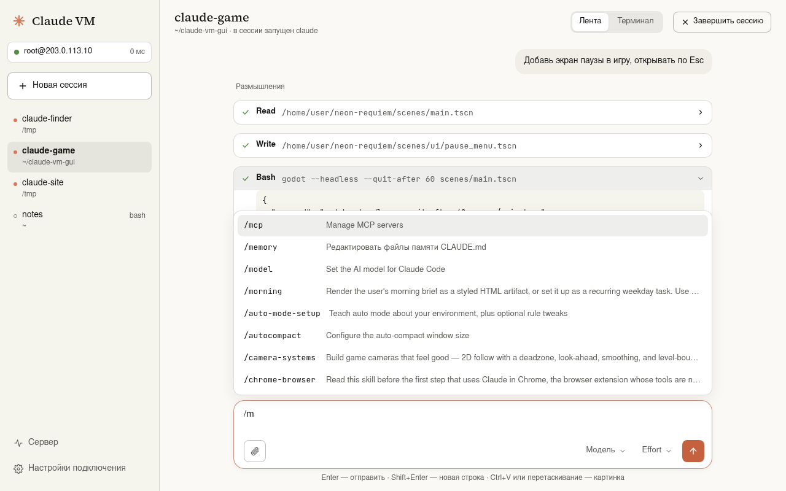
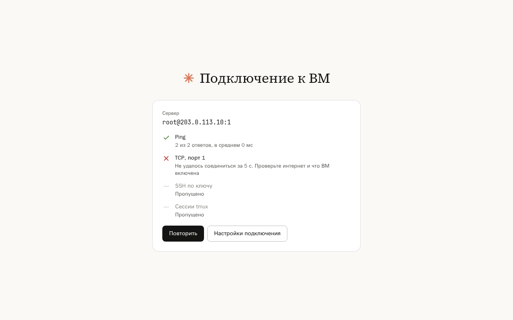
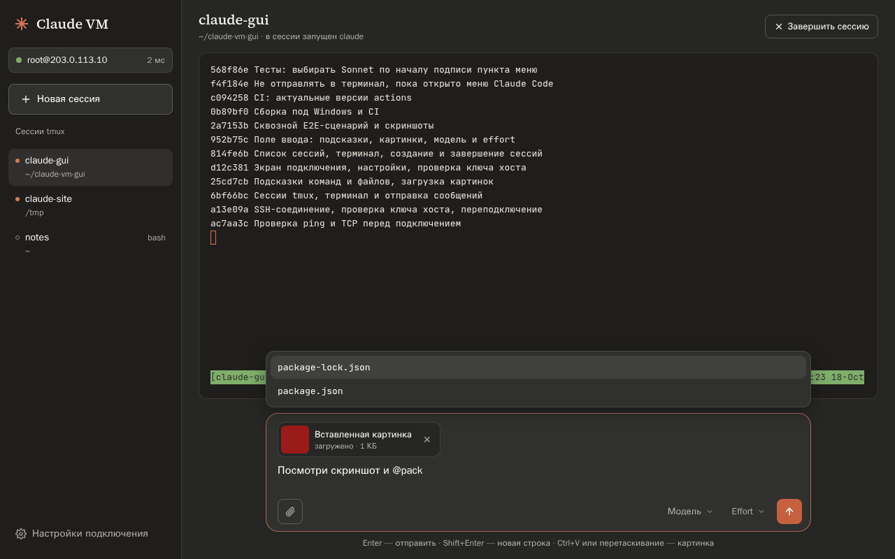
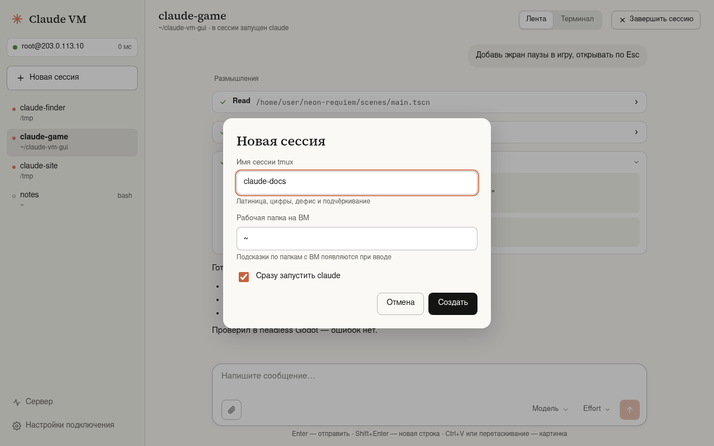
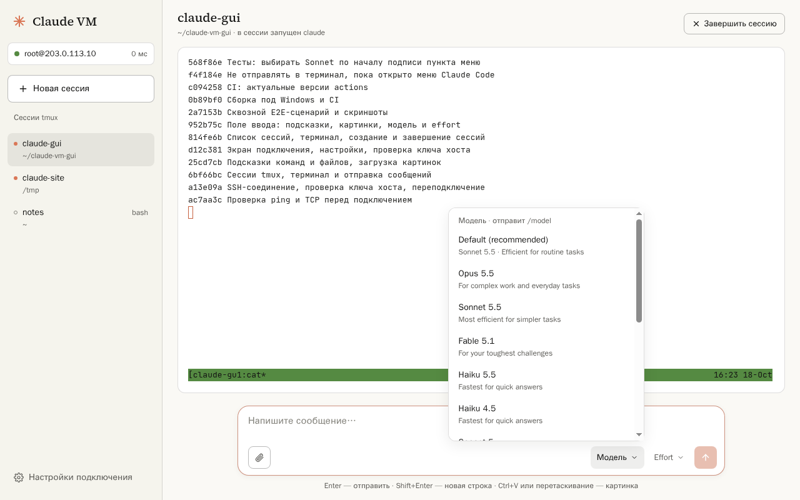
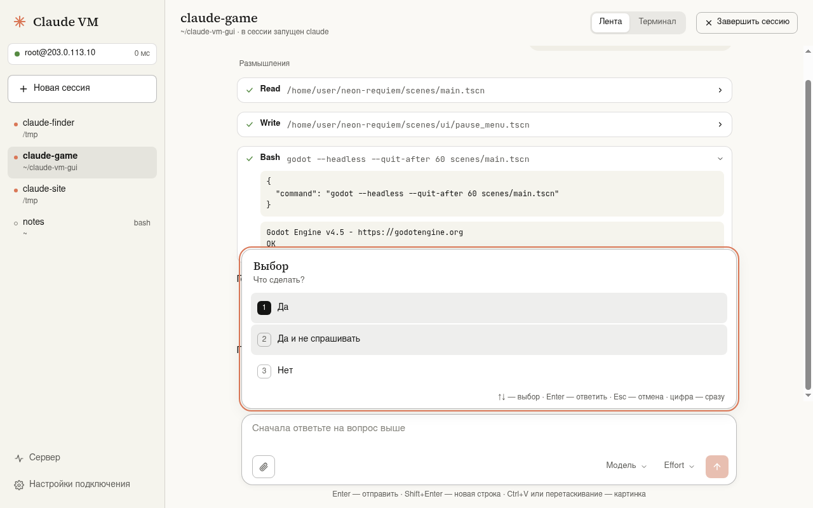
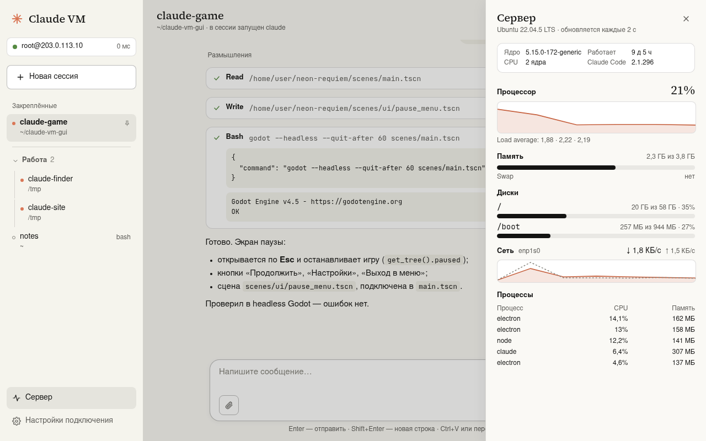
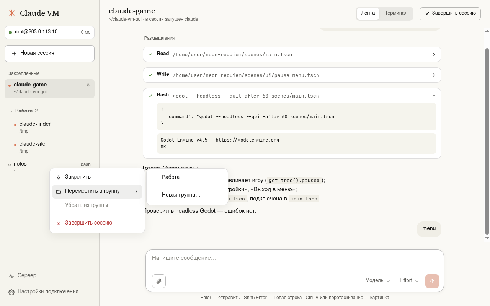

# Claude VM

Windows-приложение для работы с [Claude Code](https://docs.claude.com/en/docs/claude-code), который запущен на вашей ВМ (Ubuntu) в tmux.
Оно заменяет ручной сценарий «cmd → `ssh` → `tmux attach`/`tmux new` → `claude` → `tmux kill-session`» кнопками и показывает переписку с Claude в интерфейсе в стиле claude.ai.

Приложение подключается только к вашей ВМ по SSH. К серверам Anthropic напрямую оно не обращается: с ними работает Claude Code на ВМ.



## Возможности

- **Проверка перед подключением**: ping (только предупреждение — многие серверы на него не отвечают) и TCP-порт SSH (обязательно).
- **Вход по SSH-ключу** (по умолчанию) или **по паролю**. Ключ, защищённый паролем, берётся из ssh-agent Windows. Пароль необязателен: он хранится в настройках зашифрованным средствами Windows (DPAPI) и пробуется после ключа, в том числе через keyboard-interactive. Ключ сервера сверяется с `known_hosts`, как у обычного `ssh`; при несовпадении подключение блокируется.
- **Сессии tmux**: список всех сессий (где запущен claude, какие открыты ещё и в cmd), новая сессия с рабочей папкой и автозапуском `claude`, завершение с подтверждением. Сессии продолжают жить на ВМ — их можно открыть и из cmd.
- **Порядок сессий**: перетаскивание, закрепление (ПКМ → «Закрепить», булавка, закреплённые всегда наверху), именованные группы со сворачиванием и закреплением, страницы, если всё не помещается. Раскладка хранится на ПК отдельно для каждой ВМ; tmux не меняется.
- **Лента вместо терминала**, пока в сессии работает claude: сообщения, ответы в markdown, вызовы инструментов с результатами (раскрываются по клику), строка «Claude думает…» и кнопка «Остановить». Содержимое берётся из журнала Claude Code на ВМ (`~/.claude/projects/…`).
- **Меню Claude Code карточкой в ленте**: запрос разрешения, AskUserQuestion (в том числе несколько вопросов и множественный выбор чекбоксами, свой ответ), «доверять папке?», `/model` с effort — радиокнопки, выбор стрелками, Enter, Esc, цифрами или мышью. После ответа в ленте остаётся строка «вопрос → выбрано: …». Незнакомые экраны (например, `/config`) и сессии без claude показываются настоящим терминалом; переключатель «Лента | Терминал» — в шапке.
- **Поле ввода как на claude.ai**: подсказки по `/` (команды и скиллы с ВМ) и `@` (файлы рабочей папки), любые файлы до 50 МБ (Ctrl+V, перетаскивание, скрепка; в ленте картинка видна целиком, текстовый файл раскрывается), выбор модели (`/model`) и effort (`/effort`).
- **Отправка одним Enter**: картинки и длинный текст Claude Code сначала сворачивает в `[Image #1]`/`[Pasted text …]`; приложение жмёт Enter, только когда поле ввода устоялось, и проверяет, что сообщение ушло.
- **Безопасная отправка**: текст уходит в терминал, только если в сессии работает claude, а не обычная оболочка, и не открыто меню Claude Code (запрос разрешения и т. п.) — иначе Enter выбрал бы пункт по умолчанию. Сообщение, начинающееся с `!`, Claude Code выполняет как команду bash — так же, как в консоли.
- **Панель «Сервер»**: загрузка CPU графиком, load average, память и swap, место на дисках, сеть, топ процессов (у claude — имя сессии), ОС, ядро, время работы, версия Claude Code. Всё читается одной командой по SSH, на ВМ ничего не ставится.
- **Обрыв связи**: плашка «Связь потеряна», автоматическое переподключение, терминал возвращается в ту же сессию.
- **Окно tmux под активное устройство**: если сессия открыта и здесь, и на телефоне, при возврате в окно приложения tmux подстраивает окно под этот экран.
- **Баннер «Доступно обновление»**, когда на GitHub вышла новая версия (нажатие — страница релиза, крестик — скрыть эту версию).
- Светлая и тёмная темы (по умолчанию — как в Windows).

| Подключение | Тёмная тема |
|---|---|
|  |  |
| **Новая сессия** | **Модель и effort** |
|  |  |
| **Меню Claude Code карточкой** | **Панель «Сервер»** |
|  |  |
| **Закрепление и группы** | |
|  | |

## Установка

1. Скачайте `Claude VM Setup <версия>.exe` (установщик) или `Claude VM <версия>.exe` (портативная версия, без установки) со страницы [Releases](https://github.com/Liotto1337/claude-vm-gui/releases).
2. Приложение не подписано сертификатом, поэтому при первом запуске Windows SmartScreen покажет предупреждение: «Подробнее» → «Выполнить в любом случае».
3. При первом запуске откроются настройки: адрес ВМ, порт (22), пользователь (`root`), путь к ключу (`%USERPROFILE%\.ssh\id_ed25519`) и, если нужно, пароль.

### Что нужно на ВМ

- `tmux` (`sudo apt install tmux`) и установленный [Claude Code](https://docs.claude.com/en/docs/claude-code) с выполненным входом.
- Ваш открытый ключ в `~/.ssh/authorized_keys` — то же, что нужно для `ssh` из cmd.

Ничего дополнительно на ВМ ставить не нужно. Прикреплённые файлы загружаются в `~/.cache/claude-vm-gui/uploads/` (имя — дата, время и исходное название) и удаляются через 7 дней.

## Где хранятся настройки

`%APPDATA%\Claude VM\config.json` (пароль — только в зашифрованном виде), порядок и группы сессий — `%APPDATA%\Claude VM\layout.json`. Ключ сервера при первом подключении (после вашего подтверждения отпечатка) дописывается в `%USERPROFILE%\.ssh\known_hosts`.

## Разработка

Нужен Node.js 22.

```bash
npm install                 # заодно включает git-хук .githooks/pre-commit
cp vm.config.example.json vm.config.json   # адрес ВМ, порт, пользователь, ключ
npm run dev                 # приложение с горячей перезагрузкой
npm test                    # модульные тесты
npm run test:int            # интеграционные тесты против ВМ (нужен тестовый ключ, см. ниже)
npm run test:e2e            # E2E в Electron (на Linux без экрана: xvfb-run -a npm run test:e2e)
npm run build:win           # установщик и портативная версия в release/ (на Windows)
npm run screenshots         # скриншоты для README
```

`vm.config.json` в `.gitignore`. Хук `pre-commit` отклоняет коммит, если адрес из него встретился в любом добавленном файле.

Тестовые переменные окружения: `CVG_USER_DATA` (папка настроек), `CVG_KNOWN_HOSTS`, `CVG_TMUX_SOCKET` (отдельный сервер tmux), `CVG_CLAUDE_DIR` (каталог Claude Code вместо `~/.claude`), `CVG_CLAUDE_CMD` (команда вместо `claude`, например фейковый `tests/fixtures/fake-claude.mjs`), `CVG_FAKE_CLAUDE=1`, `CVG_DEMO_HOST`, `CVG_TEST_HOOKS=1`. Снимки экранов настоящего Claude Code для фикстур: `node scripts/dev/fake-anthropic.mjs` и `scripts/dev/capture-screen.sh` — claude работает с фейковым API, запросов к модели нет.

Интеграционные и E2E-тесты запускаются на самой ВМ и подключаются к `127.0.0.1` ключом `~/.ssh/cvg_test_ed25519`, разрешённым в `authorized_keys` только с localhost (`from="127.0.0.1,::1"`). Без этого ключа они пропускаются. Тесты работают только с сессиями `cvg-test-*` и не отправляют запросов к модели.

Сборка `.exe` и смоук-тест на Windows выполняются в GitHub Actions (`.github/workflows/windows.yml`); при теге `v*` создаётся релиз.

Карта проекта для Obsidian — в папке [`obsidian/`](obsidian/Claude%20VM%20GUI.md).

## Лицензии

Код — MIT. Шрифты Source Serif 4 и JetBrains Mono — SIL Open Font License. Приложение не связано с Anthropic; Claude и Claude Code — продукты Anthropic.
